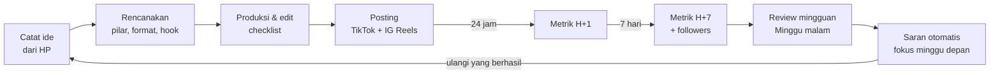

# PRD: Galeri & Studio Karya (nama sementara)

28 Oktober 2026 · Andi · v2: content planner digabung dengan galeri publik

## Ringkasan

Satu web app, satu domain, dengan dua sisi:

- **Galeri (publik)** di `/`: etalase karya gambar dan patung clay milik Andi, ditampilkan seperti katalog marketplace (foto, spesifikasi, status, harga bila dijual). Isinya berasal dari karya yang diterbitkan di Studio. Di fase berikutnya Galeri berkembang menjadi toko untuk menjual karya.
- **Studio (privat)** di `/studio`: content planner yang dibangun di Fase 1 (ide, pipeline, kalender, proyek, nanti analitik), ditambah pengelolaan karya untuk Galeri. Hanya bisa dibuka setelah login.

Studio tetap bertujuan menaikkan followers dan engagement TikTok/Instagram lewat ritme 2-3 post per minggu yang konsisten dan keputusan berdasarkan data sendiri. Galeri memberi tempat permanen yang rapi untuk karya jadi, yang selama ini hanya tersebar di feed media sosial.

**Masalah yang diselesaikan**

- Ide muncul saat jam kerja dan hilang sebelum sempat dicatat.
- Produksi gambar dan clay butuh berhari-hari, sehingga ritme posting mudah bolong.
- Tidak ada catatan konten mana yang berhasil, jadi konten berikutnya dipilih berdasarkan feeling.
- Data TikTok dan Instagram terpisah dan sulit dibandingkan.
- Karya jadi hanya tersebar di feed media sosial; belum ada etalase permanen untuk ditunjukkan ke calon kolektor atau pembeli.

**Tujuan produk**

1. Menjaga ritme 2-3 post per minggu: aplikasi selalu menunjukkan apa yang harus dikerjakan hari ini.
2. Mencatat performa tiap post dalam kurang dari 1 menit.
3. Mengubah data menjadi saran konkret: pilar, format, hook, dan jam posting mana yang perlu diulang.
4. Menampilkan karya di Galeri publik yang rapi di HP dan desktop, lengkap dengan cerita proses dan tautan ke video TikTok/Instagram.
5. Menyiapkan data karya (foto, ukuran, ketersediaan, harga) sejak awal, supaya Galeri bisa menjadi toko tanpa dibangun ulang.
6. Mempercepat persiapan konten dan membaca hasilnya dengan asisten AI: draf ide, hook, script, caption, dan teks karya; ringkasan analisis mingguan. AI hanya membuat draf, keputusan tetap di tangan Andi.

**Metrik sukses (diukur di aplikasi)**

| Metrik | Target |
| --- | --- |
| Konsistensi posting | Minimal 2 post per minggu di 10 dari 12 minggu pertama |
| Kelengkapan data | Minimal 90% post punya snapshot metrik 7 hari |
| Kebiasaan evaluasi | Review mingguan terisi minimal 3 dari 4 minggu per bulan |
| Pertumbuhan akun | Target followers dan engagement rate ditetapkan saat onboarding (lihat pertanyaan terbuka) |
| Galeri terisi | Minimal 10 karya terbit dalam 1 bulan setelah Galeri live |
| Draf AI berguna | Minimal 60% draf AI dipakai (dengan atau tanpa edit), dihitung dari log AI |
| Biaya AI terkendali | Biaya AI per bulan tidak melewati batas di Pengaturan |

## Pengguna dan konteks

Penggunanya satu orang: Andi, kreator yang juga bekerja kantoran (berangkat sekitar 08.00, pulang sekitar 18.00). Produksi konten terjadi di malam hari kerja dan akhir pekan.

| Aspek | Detail |
| --- | --- |
| Niche | Proses belajar menggambar (anatomi, dimulai dari tangan) dan membuat patung clay |
| Platform | TikTok dan Instagram (Reels, carousel, story) |
| Ritme | 2-3 post per minggu; satu konten dipakai di dua platform |
| Waktu produksi | Malam hari kerja dan akhir pekan |
| Perangkat | Laptop untuk perencanaan dan analitik; HP untuk mencatat ide dan input metrik |

**Kebutuhan utama**

- Mencatat ide dalam 10 detik dari HP, kapan saja.
- Tahu konten apa yang harus direkam atau diedit malam ini.
- Memecah satu proyek clay atau gambar yang panjang menjadi beberapa post berseri.
- Melihat perbandingan sederhana: konten apa yang berhasil dan apa yang tidak, per platform.

**Pengunjung Galeri** (publik, tanpa login): followers yang datang dari link di bio TikTok/Instagram (kebanyakan dari HP), kolektor, dan calon pembeli. Mereka butuh:

- Melihat karya dengan foto yang bagus dan cepat dimuat.
- Tahu ukuran, bahan, tahun, dan apakah karya tersedia atau sudah terjual.
- Melihat proses pembuatannya.
- Cara mudah menghubungi Andi. Nanti: membeli langsung.

## Strategi konten bawaan

Aplikasi diisi 5 pilar default yang bisa diubah, dan setiap konten wajib punya satu pilar, satu format, dan satu tipe hook. Tag wajib inilah yang membuat analitik bisa menjawab "apa yang berhasil".

**Pilar default**

| Pilar | Isi | Contoh konten | Porsi awal |
| --- | --- | --- | --- |
| Progres Gambar | Perjalanan belajar menggambar, latihan, before/after | "Hari ke-30 belajar gambar tangan" | 30% |
| Proses Clay | Proses patung dari armature sampai finishing | Time-lapse sculpt kepala karakter | 30% |
| Showcase | Hasil akhir gambar atau patung, reveal | Reveal 360 derajat patung jadi | 15% |
| Tips dan Tutorial | Pelajaran, alat, kesalahan pemula | "3 kesalahan pemula saat pakai clay" | 15% |
| Behind the Scenes | Meja kerja, alat, kegagalan, cerita personal | Patung retak dan cara memperbaikinya | 10% |

**Format default:** Time-lapse, Before/After, Tutorial singkat, Voice-over cerita, Carousel foto (IG), Reveal.

**Tipe hook default:** Hasil di depan, Hari ke-N, Pertanyaan, Kesalahan atau gagal, Transformasi, Tantangan.

**Konsep seri.** Satu proyek panjang dipecah menjadi beberapa post. Contoh proyek patung clay: Part 1 armature, Part 2 bentuk dasar, Part 3 detail, Part 4 reveal. Satu proyek akhir pekan bisa mengisi 3-4 slot posting.

**Ritme default (bisa diubah di Pengaturan)**

| Kegiatan | Waktu default |
| --- | --- |
| Batch rekam (gambar dan clay) | Sabtu dan Minggu |
| Editing | Senin dan Rabu malam |
| Slot posting | Selasa, Kamis, Sabtu pukul 19.00 WIB |
| Input metrik | 24 jam dan 7 hari setelah posting |
| Review mingguan | Minggu malam |

Jam posting di atas adalah hipotesis awal. Setelah data cukup, aplikasi menyarankan jam yang terbukti terbaik.

## Struktur situs dan navigasi

Satu domain, dua sisi. Semua URL Studio diawali `/studio` dan wajib login; selain itu publik.

| Sisi | URL | Akses |
| --- | --- | --- |
| Galeri | `/`, `/karya`, `/karya/[slug]`, `/tentang` | Publik |
| Login | `/masuk` | Publik (form login Studio, tidak ditautkan dari Galeri) |
| Studio | `/studio/...` | Hanya setelah login |

### Galeri (publik)

Header berisi nama/logo, menu Beranda · Karya · Tentang, dan ikon Instagram/TikTok. Di HP menu menjadi tombol hamburger. Footer berisi tautan sosial, kontak, dan tahun hak cipta.

| No | Halaman | URL | Fungsi |
| --- | --- | --- | --- |
| G1 | Beranda | `/` | Kesan pertama dan karya unggulan |
| G2 | Karya | `/karya` | Katalog semua karya terbit, gaya marketplace |
| G3 | Detail karya | `/karya/[slug]` | Foto, spesifikasi, cerita proses, ketersediaan/harga, kontak |
| G4 | Tentang | `/tentang` | Profil, cara kerja, kontak (lihat Pertanyaan terbuka) |

### Studio (privat)

Studio punya 11 menu. Di desktop tampil sebagai sidebar; di HP tampil sebagai bottom navigation berisi Beranda, Pipeline, tombol + Ide di tengah, Kalender, dan Lainnya. Menu Karya ditaruh di sidebar setelah Proyek dan Seri.

| No | Menu | Route | Fungsi | Isi utama |
| --- | --- | --- | --- | --- |
| 1 | Beranda | `/studio` | Apa yang harus dikerjakan hari ini | Progres post minggu ini, tugas hari ini, metrik yang perlu diisi, 3 kartu saran |
| 2 | Bank Ide | `/studio/ide` | Menampung semua ide | Daftar ide, filter pilar/medium, skor potensi vs effort |
| 3 | Pipeline | `/studio/pipeline` | Melacak produksi konten | Kanban: Perencanaan, Produksi, Editing, Siap Posting, Posted |
| 4 | Kalender | `/studio/kalender` | Menjadwalkan posting | Tampilan minggu/bulan, slot kosong, drag and drop jadwal |
| 5 | Proyek dan Seri | `/studio/proyek` | Mengelola proses karya panjang | Proyek gambar/clay, tahap, foto progres, post yang dihasilkan |
| 6 | Postingan | `/studio/postingan` | Arsip post dan input metrik | Daftar post per platform, badge metrik tertunda, form metrik |
| 7 | Analitik | `/studio/analitik` | Melihat apa yang berhasil | Grafik followers, engagement, perbandingan pilar/format/hook/jam, top dan bottom post |
| 8 | Eksperimen | `/studio/eksperimen` | Menguji hipotesis | Hipotesis, variabel, post A vs B, kesimpulan |
| 9 | Review Mingguan | `/studio/review` | Evaluasi dan fokus minggu depan | Ringkasan otomatis, form refleksi, rencana minggu depan |
| 10 | Pengaturan | `/studio/pengaturan` | Konfigurasi | Pilar, format, hook, slot jadwal, target, profil publik, akun dan keamanan, ekspor dan backup |
| 11 | Karya | `/studio/karya` | Mengelola karya untuk Galeri | Daftar karya, foto, spesifikasi, publikasi, ketersediaan dan harga |

Tombol **+ Ide** selalu tersedia di semua halaman Studio (floating button di HP, shortcut `N` di desktop).

## Spesifikasi Studio (per menu)

### 1. Beranda

- Kartu progres minggu ini: "2 dari 3 post", dengan streak minggu berturut-turut yang memenuhi target.
- Tugas hari ini: konten di Pipeline yang dijadwalkan dikerjakan atau diposting hari ini.
- Metrik tertunda: post yang sudah lewat 24 jam atau 7 hari tapi metriknya belum diisi, dengan tombol isi cepat.
- 3 kartu saran teratas dari mesin aturan.
- Grafik mini followers TikTok dan Instagram 30 hari terakhir.

### 2. Bank Ide

- Tambah ide cepat: cukup judul; pilar, medium (Gambar/Clay/Campuran), catatan, link referensi, foto referensi opsional.
- Skor potensi (1-5) dan effort (1-5); daftar bisa diurutkan berdasarkan skor gabungan.
- Status ide: Baru, Dipilih, Diarsipkan.
- Aksi **Jadikan Konten** memindahkan ide ke Pipeline di kolom Perencanaan.
- Penanda "bank ide menipis" jika ide berstatus Baru kurang dari 5.

### 3. Pipeline

- Kanban 5 kolom: Perencanaan, Produksi, Editing, Siap Posting, Posted. Drag and drop.
- Kartu menampilkan judul, pilar (warna), format, jadwal posting, ikon platform.
- Detail konten: judul, pilar, format, tipe hook, teks hook 3 detik pertama, script/storyboard, shot list, target durasi, proyek dan nomor part seri.
- Checklist produksi bawaan: hook di 3 detik pertama, subtitle, cover, CTA, caption, hashtag, audio. Bisa diubah di Pengaturan.
- Versi per platform: satu konten punya versi TikTok dan Instagram, masing-masing dengan caption, hashtag, jadwal, status sendiri.
- Pindah ke Posted meminta link post dan waktu posting aktual, lalu otomatis membuat jadwal input metrik.
- Penanda kartu macet jika di kolom yang sama lebih dari 7 hari.

### 4. Kalender

- Tampilan minggu (default) dan bulan.
- Slot posting default tampil sebagai kotak kosong; slot belum terisi diberi warna peringatan.
- Drag kartu dari daftar "Siap Posting" ke slot untuk menjadwalkan.
- Warna per pilar.
- Hari produksi (rekam, edit) bisa ditandai sebagai blok waktu.

### 5. Proyek dan Seri

- Proyek = satu proses kerja, misalnya "Patung kepala naga" atau "30 hari gambar tangan". Satu proyek bisa menghasilkan satu atau beberapa karya (menu 11).
- Field: judul, medium, tahap, tanggal mulai dan selesai, catatan, galeri foto progres (mulai Fase 2 foto bisa diunggah langsung, tidak hanya lewat URL).
- Aksi **Jadikan Karya**: membuat karya Draft dari proyek (judul, medium, tahun, dan foto progres terpilih ikut disalin).
- Daftar konten dari proyek, diurutkan berdasarkan nomor part.
- Aksi **Buat Seri**: membuat N konten sekaligus (Part 1..N) di Pipeline dengan pilar dan format yang sama.

### 6. Postingan

- Daftar post per platform; filter platform, pilar, rentang tanggal.
- Badge status metrik: Perlu H+1, Perlu H+7, Lengkap.
- Form metrik singkat (< 1 menit): views, likes, komentar, shares, saves, followers dari post, rata-rata waktu tonton, completion rate (opsional).
- Snapshot followers akun per platform, diminta sekali seminggu saat review.
- Detail post: metrik terhitung (ER, save rate, dll.) dan perbandingan terhadap median post sebelumnya.

### 7. Analitik

- Filter: platform, rentang waktu (7, 30, 90 hari), medium.
- Kartu KPI: total post, rata-rata ER, followers bertambah, post per minggu.
- Grafik garis followers per platform.
- Grafik batang median skor per pilar, format, tipe hook, hari, jam posting.
- Tabel top 5 dan bottom 5 post berdasarkan skor relatif.
- Perbandingan TikTok vs Instagram untuk konten yang sama.
- Grup dengan kurang dari 3 post diberi label "data belum cukup".

### 8. Eksperimen

- Hipotesis, variabel (hook, format, jam, durasi, cover), metrik penentu.
- Hubungkan post varian A dan B.
- Setelah semua post punya H+7, tampilkan perbandingan; tandai Terbukti / Tidak terbukti / Belum jelas + catatan.

### 9. Review Mingguan

- Pengingat Minggu malam di Beranda.
- Ringkasan otomatis: post vs target, followers bertambah, post terbaik dan terburuk, saran aktif.
- Refleksi: Apa yang berhasil? Apa yang diulang? Apa yang dihentikan?
- Isi snapshot followers per platform.
- Fokus minggu depan + pilih 2-3 konten untuk slot minggu depan.
- Riwayat review.

### 10. Pengaturan

- Kelola pilar (nama, warna, porsi target), format, tipe hook, item checklist.
- Target mingguan post dan slot posting default.
- Handle TikTok dan Instagram.
- Bobot skor konten.
- Profil publik untuk Galeri: nama tampilan, tagline, bio singkat, foto profil, kota (opsional), tautan Instagram/TikTok, nomor WhatsApp dan email kontak. Field yang kosong tidak ditampilkan di Galeri.
- Akun dan keamanan: ganti password, daftar sesi aktif, keluar dari semua perangkat.
- Panduan AI dan pemakaian AI (mulai Fase 3, lihat bagian "Asisten AI").
- Ekspor CSV/JSON dan backup database.

### 11. Karya (untuk Galeri)

Karya adalah satu objek seni jadi yang ditampilkan di Galeri (dan nanti dijual): satu gambar, satu patung, atau satu set.

- **Bedanya dengan Proyek:** proyek adalah proses kerja dan bisa menghasilkan banyak karya.
- **Bedanya dengan Konten:** konten adalah video/post media sosial tentang prosesnya.

Isi menu:

- Daftar karya (grid thumbnail) dengan filter publikasi (Draft, Terbit, Diarsipkan), medium, dan ketersediaan.
- Buat karya kosong, atau dari detail Proyek lewat **Jadikan Karya**.
- **Field:** judul, slug URL (otomatis dari judul, bisa diubah), ringkasan satu kalimat, cerita/deskripsi, medium, tahun selesai, ukuran (P × L × T cm), bahan, berat (opsional, untuk ongkir nanti), proyek asal.
- **Foto:**
  - Unggah beberapa foto (JPG, PNG, atau WebP; maks. 15 MB per file). Foto HEIC dari iPhone biasanya otomatis dikonversi ke JPEG oleh browser; jika tidak, ditolak dengan pesan jelas.
  - Urutkan, pilih cover, dan isi teks alternatif.
  - Server mengecilkan foto, mengubahnya ke WebP, dan menghapus metadata EXIF (termasuk lokasi GPS) sebelum disimpan.
- **Video proses:** pilih konten berstatus Posted. Galeri menampilkan tautan ke post TikTok/Instagram-nya.
- **Ketersediaan:** Koleksi pribadi (tidak dijual), Tersedia, Dipesan, atau Terjual. Harga dalam Rupiah, dengan pilihan tampilkan harga atau "Harga atas permintaan".
- **Unggulan:** tandai karya untuk tampil di Beranda Galeri, dengan urutan.
- **Publikasi:**
  - Alurnya Draft → Terbit (mencatat `publishedAt`) → Diarsipkan. Hanya karya Terbit yang muncul di Galeri.
  - Pratinjau Draft di `/studio/karya/[id]/pratinjau` memakai tampilan detail Galeri.
- **Syarat terbit** (dicek server): judul, medium, tahun, dan minimal 1 foto dengan teks alternatif.

## Spesifikasi Galeri (publik)

Prinsip desain:

- Foto karya adalah pusat perhatian; tampilannya bersih.
- Cepat di HP, karena pengunjung kebanyakan datang dari link di bio.
- Kartu dan halaman detail memakai struktur produk marketplace, supaya fase Toko cukup menambah tombol beli, keranjang, dan checkout.

### G1. Beranda `/`

- Hero: satu karya unggulan dengan foto besar, nama, tagline, dan tombol "Lihat karya".
- Karya unggulan (maks. 8, urutan diatur di Studio) dalam grid kartu.
- Karya terbaru (6 karya terakhir yang terbit).
- Pintasan per medium ("Gambar", "Patung clay") ke katalog yang sudah difilter.
- Ringkasan profil dan tautan Instagram/TikTok.

### G2. Katalog karya `/karya`

- Grid kartu produk: 2 kolom di HP, 3-4 kolom di desktop.
- Isi kartu: foto cover rasio 4:5, judul, medium dan tahun, badge ketersediaan, serta harga (jika ditampilkan) atau "Koleksi pribadi".
- Filter: medium (Gambar, Clay, Campuran), ketersediaan (Semua, Tersedia, Terjual/Koleksi), dan tahun.
- Urutan: Terbaru atau Unggulan. Urutan berdasarkan harga ditambahkan saat toko aktif.
- Pencarian berdasarkan judul.
- Filter dan urutan disimpan di URL (mis. `/karya?medium=CLAY&status=AVAILABLE`) supaya bisa dibagikan.
- 24 karya per halaman, dengan tombol "Muat lagi". Ada empty state jika filter tidak menemukan apa-apa.

### G3. Detail karya `/karya/[slug]`

- **Foto:** galeri bisa digeser di HP, thumbnail di desktop; ketuk untuk layar penuh dan zoom.
- **Panel info** seperti halaman produk: judul, badge ketersediaan, harga atau "Harga atas permintaan", medium, ukuran, bahan, dan tahun.
- **Tombol utama Tanya karya ini:** membuka WhatsApp (atau email) dengan pesan berisi judul dan URL karya. Di fase Toko tombol ini menjadi **Beli** / **Tambah ke keranjang**.
- **Cerita karya:** deskripsi.
- **Proses:** foto progres terpilih dan tautan "Tonton prosesnya di TikTok/Instagram". Hanya tautan biasa, tanpa embed script pihak ketiga.
- **Karya lain** dengan medium yang sama (4 kartu).
- **Bagikan:** tombol salin tautan.
- Jika judul diganti, slug lama tetap bisa dibuka dan diarahkan ke slug baru.

### G4. Tentang `/tentang`

- Foto, bio, perjalanan belajar menggambar dan clay, kontak, tautan sosial.

### Kebutuhan Galeri

- **SEO:**
  - Judul dan deskripsi per halaman.
  - Gambar Open Graph = foto cover, supaya tautan tampil bagus saat dibagikan di WhatsApp/Instagram.
  - `sitemap.xml`, dan `robots.txt` yang melarang `/studio` dan `/masuk`.
  - Data terstruktur schema.org `VisualArtwork`, nanti ditambah `Product` + `Offer`.
- **Performa:**
  - Halaman Galeri di-cache dan diperbarui saat karya disimpan di Studio.
  - Gambar lewat `next/image`: ukuran responsif, WebP/AVIF, lazy load.
  - Target LCP < 2,5 detik di HP dengan 4G.
- **Batas data:** Galeri tidak pernah menampilkan data Studio, yaitu ide, pipeline, metrik, karya Draft, harga yang disembunyikan, atau catatan internal. Query Galeri terpisah dan hanya memilih field publik.
- **Tampilan:** bahasa Indonesia (lihat Pertanyaan terbuka soal Inggris); mode terang/gelap mengikuti sistem.
- **Halaman 404** yang ramah untuk karya yang tidak ada atau belum terbit.
- Tanpa pelacak atau analytics pihak ketiga.

## Autentikasi dan keamanan

Studio hanya untuk satu pemilik. Tidak ada pendaftaran publik.

- **Login di `/masuk`** dengan email + password. Akun admin dibuat lewat skrip CLI (`npm run admin:create`), bukan dari web.
- **Password:**
  - Di-hash dengan scrypt (bawaan Node `crypto`, tanpa modul native) dan salt per akun.
  - Minimal 12 karakter.
- **Sesi:**
  - Disimpan di database (tabel `Session`). Cookie berisi token acak dengan atribut `httpOnly`, `Secure`, `SameSite=Lax`; di DB hanya hash token yang disimpan.
  - Berlaku 30 hari dan diperpanjang saat dipakai.
  - Bisa dicabut lewat "Keluar dari semua perangkat".
- **Pembatasan percobaan login:**
  - 5 kali gagal dalam 15 menit (per IP dan per email) → dikunci 15 menit.
  - Pesan error tidak membedakan email salah dan password salah.
- **Lapisan pemeriksaan** (pola Next.js 16):
  - `src/proxy.ts` melakukan cek cepat untuk semua `/studio/*`: jika tidak ada cookie sesi, arahkan ke `/masuk`.
  - Pemeriksaan sesungguhnya ada di Data Access Layer `requireAdmin()`. Fungsi ini dipanggil di layout Studio, setiap halaman, setiap Server Action, dan setiap Route Handler Studio. Proxy saja tidak cukup.
- **Unggah file** hanya untuk admin:
  - Tipe file dicek dari isi file, bukan dari nama.
  - Ada batas ukuran.
  - File diproses ulang dengan sharp (menghapus EXIF/GPS) dan disimpan dengan nama acak.
- **Header keamanan:** Content-Security-Policy (termasuk `frame-ancestors 'none'`), `Referrer-Policy`, dan HSTS saat di-hosting.
- **Rahasia** (secret sesi, kredensial database) hanya di variabel lingkungan, tidak pernah di repo.
- **2FA TOTP wajib** dengan aplikasi authenticator, dengan 10 kode pemulihan sekali pakai. Reset darurat hanya lewat skrip CLI di server.
- Galeri tidak memasang cookie apa pun untuk pengunjung.

## Alur pengguna

Alur utama adalah siklus mingguan: ide dicatat, diproduksi, diposting, diukur dua kali, lalu review mengarahkan konten minggu berikutnya.



Keputusan dan saran memakai angka H+7.

**Flow 1: Onboarding**

1. Isi handle TikTok dan Instagram serta followers saat ini.
2. Tinjau 5 pilar default; ubah nama, warna, atau porsi jika perlu.
3. Tetapkan target mingguan (default 3 post) dan slot posting.
4. Tetapkan target followers dan ER untuk 3 bulan.
5. Catat minimal 5 ide pertama, lalu masuk ke Beranda.

**Flow 2: Mencatat ide dari HP**

1. Ketuk + Ide dari halaman mana pun.
2. Ketik judul; pilih pilar dan medium jika sempat.
3. Simpan. Ide masuk Bank Ide berstatus Baru (tersimpan offline jika tidak ada internet).

**Flow 3: Dari ide sampai posting**

1. Di Bank Ide, pilih ide berskor tinggi → Jadikan Konten.
2. Di detail konten, isi format, tipe hook, teks hook, script, shot list (kolom Perencanaan).
3. Saat merekam, pindahkan ke Produksi; centang checklist.
4. Setelah edit, pindahkan ke Siap Posting; tulis caption dan hashtag per platform.
5. Drag kartu ke slot kosong di Kalender.
6. Setelah posting, pindahkan ke Posted dan tempel link. Sistem membuat jadwal metrik H+1 dan H+7.

**Flow 4: Mengisi metrik**

1. Beranda menampilkan badge "Perlu H+1" / "Perlu H+7".
2. Buka analytics di TikTok/Instagram, isi form metrik.
3. Aplikasi menampilkan ER, skor, dan skor relatif.

**Flow 5: Review mingguan**

1. Buka Review Mingguan dari pengingat.
2. Baca ringkasan otomatis.
3. Isi followers terbaru per platform.
4. Jawab 3 pertanyaan refleksi, tulis fokus minggu depan.
5. Pilih 2-3 konten dan tempatkan di slot minggu depan.

**Flow 6: Proyek clay berseri**

1. Buat proyek "Patung kepala naga", medium Clay.
2. Buat Seri, 4 part → empat kartu masuk Pipeline.
3. Unggah foto progres dan rekam bahan untuk tiap part.
4. Post Part 1-4 sesuai slot; aplikasi menyarankan lanjutkan seri jika part sebelumnya di atas median.

**Flow 7: Menerbitkan karya ke Galeri**

1. Proyek "Patung kepala naga" selesai. Di detail proyek pilih **Jadikan Karya**.
2. Unggah 3-6 foto karya jadi, pilih cover, isi teks alternatif.
3. Isi ukuran, bahan, tahun, dan cerita; pilih konten Posted sebagai video proses.
4. Pilih ketersediaan (mis. Koleksi pribadi) dan tandai Unggulan.
5. Terbitkan. Karya muncul di `/karya` dan Beranda Galeri; tautannya bisa dibagikan di bio atau caption.

**Flow 8: Pengunjung dari link bio**

1. Ketuk link di bio Instagram, lalu Beranda Galeri terbuka di HP.
2. Geser karya unggulan, buka satu karya.
3. Lihat foto, ukuran, dan proses; tonton video prosesnya di TikTok.
4. Ketuk **Tanya karya ini**. WhatsApp terbuka dengan pesan yang sudah berisi judul dan tautan karya.

**Flow 9: Menyiapkan konten dengan AI**

1. Di detail konten "Time-lapse gambar tangan hari ke-30", pilih tipe hook "Hari ke-N", lalu ketuk **Bantu AI** di field Teks hook.
2. Panel menampilkan 5 opsi hook. Ketik instruksi tambahan "lebih santai", lalu **Buat ulang**.
3. Ketuk **Pakai** pada satu opsi; teksnya masuk ke field, belum tersimpan.
4. Lakukan hal yang sama untuk script dan shot list, lalu di versi TikTok/IG untuk caption dan hashtag.
5. Edit seperlunya, lalu **Simpan**.

## Asisten AI (Studio)

Asisten AI membantu dua hal: **persiapan konten** (Fase 3) dan **analisis** (Fase 5, setelah data metrik tersedia). AI hanya ada di Studio, tidak di Galeri publik.

### Prinsip

- **AI membuat draf, Andi memutuskan.** Hasil AI mengisi field form sebagai draf. Tidak ada yang tersimpan, diterbitkan, atau diposting otomatis.
- **Angka dihitung kode, bukan AI.** ER, skor, median, dan peringkat dihitung `lib/analytics`; AI hanya menerima angka jadi lalu menjelaskannya.
- **AI tidak boleh mengarang fakta.** Fakta tentang Andi dan karya diambil dari Panduan AI dan data aplikasi; jika data kurang, AI diminta mengatakannya.
- **Data seperlunya.** Yang dikirim ke AI hanya Panduan AI dan data yang relevan untuk satu permintaan (ide, konten, proyek, karya, foto karya, ringkasan metrik). Tidak pernah dikirim: password, sesi, token, kode 2FA, dan nanti data pembeli.
- **Biaya terkendali.** Ada batas biaya bulanan di aplikasi, dicek sebelum setiap panggilan, ditambah batas pengeluaran di akun penyedia.

### Panduan AI (Pengaturan, tab baru)

Bahan tetap yang dipakai di setiap permintaan (bagian awal prompt yang di-cache):

- **Gaya bahasa:** santai/formal, campuran bahasa Inggris, sapaan, emoji, panjang caption, CTA favorit.
- **Contoh terbaik:** maks. 10 hook atau caption yang paling disukai, sebagai contoh gaya.
- **Fakta kreator dan karya:** alat, bahan, gaya, perjalanan belajar.
- **Hashtag** per pilar dan per platform.
- **Kata atau topik yang dihindari.**
- **Pengaturan teknis:** AI aktif/nonaktif, model (default Claude Opus 5.5), batas biaya bulanan (default US$10), batas panggilan per hari (default 100).
- **Pemakaian AI bulan ini:** jumlah panggilan, token, perkiraan biaya, persentase draf yang dipakai.

### Fitur persiapan konten (Fase 3)

| Tempat | Tombol | Hasil (draf) |
| --- | --- | --- |
| Bank Ide | Kembangkan ide | 3 variasi: judul, sudut pandang, saran pilar/format/tipe hook, alasan singkat. Tiap variasi bisa disimpan sebagai ide baru atau mengisi ide yang dibuka. |
| Bank Ide / detail Proyek | Ide dari proyek | 3-5 ide konten berseri dari proyek berjalan (tahap, catatan, foto progres). |
| Detail konten | Hook | 5 opsi teks hook 3 detik sesuai tipe hook terpilih. |
| Detail konten | Script & shot list | Draf script/storyboard, shot list, dan target durasi sesuai format. |
| Versi platform | Caption & hashtag | 2 opsi per platform: TikTok lebih singkat, Instagram lebih panjang + CTA; hashtag dari set per pilar. |
| Karya | Dari foto | Dari foto karya (maks. 4) + catatan: teks alternatif per foto, ringkasan satu kalimat, dan cerita karya. |

Pola UI yang sama di semua tempat: tombol **Bantu AI** di samping field → panel hasil dengan opsi, tombol **Pakai**, **Buat ulang**, dan kolom instruksi tambahan (mis. "lebih singkat") → perkiraan biaya kecil di panel. Hasil panjang tampil bertahap (streaming).

### Fitur analisis (Fase 5, bersama mesin aturan)

- **Review Mingguan → Draf ringkasan:** narasi dari ringkasan angka minggu itu (post vs target, top/bottom post, median per pilar/format/hook/jam, saran aturan yang aktif) dan 3 usulan fokus minggu depan. Mengisi form refleksi sebagai draf.
- **Detail post → Kenapa?:** penjelasan kenapa post di atas/bawah median, membandingkan tag (pilar, format, hook, jam, durasi) dengan post sebanding di platform yang sama.
- **Saran aturan** (`rules.ts`) tetap deterministik. AI hanya menambahkan kalimat penjelas bila diminta.
- Grup dengan kurang dari 3 post dikirim berlabel "data belum cukup", dan AI wajib menyebutkannya, bukan menarik kesimpulan.
- **Nanti:** "Tanya data" (chat) dengan alat yang hanya bisa membaca ringkasan agregat.

### Teknis

- **Penyedia:** Claude API (Anthropic), SDK resmi `@anthropic-ai/sdk`, hanya dipanggil dari server (Server Action/Route Handler) setelah `requireAdmin()`. API key di variabel lingkungan server `ANTHROPIC_API_KEY`.
- **Model:** default `claude-opus-5-5`. Model bisa diganti di Pengaturan (mis. Claude Sonnet 5.5 atau Haiku 5.5 untuk tugas ringan) setelah dibandingkan dengan set uji.
- **Output terstruktur:** fitur pengisi form memakai skema JSON (dari Zod) supaya hasil langsung cocok dengan field; teks bebas hanya untuk narasi review.
- **Gambar:** foto dikirim dari file WebP hasil unggahan, diperkecil sebelum dikirim.
- **Prompt caching** untuk Panduan AI (awalan stabil) supaya biaya per panggilan lebih kecil.
- **Prompt di kode** (`src/features/ai/prompts/`), masing-masing punya versi yang dicatat di log.
- **Log `AiRun`** untuk setiap panggilan: fitur, model, versi prompt, token, biaya, durasi, status, dan apakah draf dipakai.
- **Error** (jaringan, batas rate, permintaan ditolak model) tampil sebagai toast; isi form tidak hilang.
- **Set uji** 10-20 contoh per fitur di `src/features/ai/evals/`, dijalankan manual sebelum mengganti prompt atau model (setiap jalan memakai biaya API).

## Metrik, rumus, dan aturan saran

Semua angka dihitung dari snapshot H+7 (fallback H+1), hanya dibandingkan dalam platform yang sama. Views TikTok dan reach Instagram disimpan di field `views` tapi tidak pernah dicampur.

- **Engagement rate:** `ER = (likes + comments + shares + saves) / views × 100%`
- **Save rate** = saves / views · **Share rate** = shares / views · **Follow rate** = follows / views × 1000
- **Skor konten** (bobot default, bisa diubah): `Skor = (likes + 2·comments + 3·shares + 3·saves + 5·follows) / views × 1000`
- **Skor relatif** = skor post / median skor 10 post terakhir di platform yang sama. 1,5 = 50% lebih baik dari biasanya.
- `views = 0` → semua rate = 0 (bukan NaN/Infinity).

**Aturan saran otomatis** (aktif hanya jika grup punya ≥ 3 post; Beranda menampilkan 3 teratas)

| Prioritas | Aturan | Kondisi | Contoh saran |
| --- | --- | --- | --- |
| 1 | Ritme terancam | Post minggu ini < target dan hari ≥ Kamis | "Masih kurang 1 post. Konten siap: Time-lapse tangan Part 2." |
| 2 | Metrik tertunda | Post lewat 24 jam / 7 hari tanpa snapshot | "Isi metrik H+7 untuk 2 post." |
| 3 | Pipeline macet | Kartu di kolom sama > 7 hari | "Reveal patung naga tertahan di Editing 9 hari." |
| 4 | Pilar terbaik | Pilar dengan median skor relatif tertinggi | "Proses Clay 1,6x di atas rata-rata. Jadwalkan 1 lagi." |
| 5 | Hook terbaik | Tipe hook dengan median tertinggi | "Hook Hasil di depan unggul di TikTok." |
| 6 | Jam terbaik | Kombinasi hari+jam dengan median tertinggi | "Sabtu 19.00 di IG konsisten paling tinggi." |
| 7 | Lanjutkan seri | Part terakhir seri di atas median | "Part 2 di atas rata-rata. Siapkan Part 3." |
| 8 | Crosspost tertinggal | Konten berskor tinggi baru di satu platform | "Bagus di TikTok, belum diposting di IG." |
| 9 | Pilar terabaikan | Pilar tanpa post 14 hari | "Belum ada Tips dan Tutorial dalam 2 minggu." |
| 10 | Ide menipis | Ide Baru < 5 | "Bank ide tinggal 3." |

Angka pada contoh hanya ilustrasi.

## Model data

Rantai inti Studio: **Idea → Content → Post → MetricSnapshot**. Rantai Galeri: **Project → Artwork → ArtworkImage**, dengan Artwork ↔ Content (video proses).

| Entitas | Field utama | Relasi |
| --- | --- | --- |
| Pillar | id, name, description, color, targetShare, isActive | 1:N Idea, Content |
| Format | id, name, isActive | 1:N Content |
| HookType | id, name, isActive | 1:N Content |
| Project | id, title, medium (DRAWING, CLAY, MIXED), stage, startDate, endDate, notes | 1:N Content, ProjectPhoto |
| ProjectPhoto | id, projectId, url atau storageKey (unggahan) + width, height, caption, takenAt | N:1 Project |
| Idea | id, title, notes, medium, potential (1-5), effort (1-5), status (NEW, PICKED, ARCHIVED), refUrl, createdAt | N:1 Pillar; 1:0..1 Content |
| Content | id, ideaId, projectId, seriesPart, title, pillarId, formatId, hookTypeId, hookText, script, shotList, targetDurationSec, stage (PLANNING, PRODUCTION, EDITING, READY, POSTED), stageChangedAt | 1:N Post, ChecklistItem |
| ChecklistItem | id, contentId, label, done, order | N:1 Content |
| Post | id, contentId, platform (TIKTOK, INSTAGRAM), postType (VIDEO, REEL, CAROUSEL, STORY), caption, hashtags, scheduledAt, postedAt, url, durationSec | 1:N MetricSnapshot |
| MetricSnapshot | id, postId, kind (H1, H7, CUSTOM), recordedAt, views, likes, comments, shares, saves, follows, avgWatchSec, completionRate | N:1 Post |
| AccountSnapshot | id, platform, date, followers | unik per platform+date |
| Experiment | id, hypothesis, variable, decidingMetric, result (SUPPORTED, REJECTED, INCONCLUSIVE), notes | 1:N ExperimentPost |
| ExperimentPost | experimentId, postId, variant (A, B) | penghubung |
| WeeklyReview | id, weekStart, wins, repeat, stop, focusNext, summaryJson | satu per minggu |
| Setting | id, weeklyPostTarget, postingSlotsJson, scoreWeightsJson, tiktokHandle, igHandle, followerTargetJson, siteName, tagline, bio (singkat, Beranda), aboutText (panjang, Tentang), avatarKey, city, whatsapp, contactEmail | satu baris |
| Artwork | id, slug (unik), title, summary, description, medium, year, widthCm, heightCm, depthCm, materials, weightGram, projectId, visibility (DRAFT, PUBLISHED, ARCHIVED), availability (NOT_FOR_SALE, AVAILABLE, RESERVED, SOLD), priceIdr, showPrice, isFeatured, featuredOrder, publishedAt | N:1 Project; 1:N ArtworkImage; N:M Content |
| ArtworkImage | id, artworkId, storageKey, width, height, alt, order, isCover, isProcess (foto progres untuk bagian Proses, bukan foto karya jadi) | N:1 Artwork |
| ArtworkContent | artworkId, contentId, order | penghubung karya ↔ konten proses |
| ArtworkSlugRedirect | oldSlug (unik), artworkId | slug lama → karya |
| AdminUser | id, email (unik), passwordHash, passwordChangedAt, totpSecret (null = 2FA belum di-setup), totpLastStep (anti-replay), recoveryCodeHashes | 1:N Session |
| Session | id, tokenHash (unik), adminUserId, expiresAt, lastUsedAt, userAgent, ip | N:1 AdminUser |
| LoginChallenge | id, tokenHash (unik), adminUserId, kind (VERIFY, SETUP), pendingTotpSecret, expiresAt | tahap login 10 menit antara password benar dan 2FA |
| LoginAttempt | id, key (IP atau email), success, createdAt | dasar pembatasan login |
| AiGuide | id, isEnabled, model, voiceNotes, examplesJson, creatorFacts, hashtagSetsJson (per pilar + platform), avoidNotes, monthlyBudgetUsd, dailyCallLimit | satu baris (Fase 3) |
| AiRun | id, feature, model, promptVersion, targetType, targetId, inputTokens, outputTokens, cacheReadTokens, costUsd, durationMs, status (OK, ERROR, REFUSED), errorMessage, outputJson, accepted, createdAt | log setiap panggilan AI (Fase 3) |

**Aturan data**

- `postId + kind` unik (kecuali CUSTOM).
- `platform + date` di AccountSnapshot unik.
- Content ke POSTED butuh minimal satu Post dengan `postedAt` dan `url`.
- Satu Content punya maksimal satu Post per platform (`contentId + platform` unik).
- Format dan tipe hook boleh kosong selama Perencanaan–Editing, wajib saat Content pindah ke Siap Posting atau Posted.
- Target "post per minggu" dihitung per Content (satu konten di TikTok + IG = satu post).
- Pillar/Format/HookType tidak dihapus jika dipakai (juga ditahan di database); cukup `isActive = false`.
- Waktu disimpan UTC, ditampilkan WIB (Asia/Jakarta); minggu dimulai Senin.
- Artwork hanya bisa PUBLISHED jika punya judul, medium, tahun, dan minimal 1 foto dengan teks alternatif.
- Slug Artwork unik dan hanya huruf kecil, angka, dan tanda hubung. Saat slug berubah, slug lama disimpan di ArtworkSlugRedirect.
- Harga disimpan sebagai Rupiah bulat (`Int`). Jika `showPrice = false`, harga tidak pernah dikirim ke Galeri.
- Artwork yang sudah terjual tidak dihapus, hanya diarsipkan (nanti dirujuk oleh pesanan).
- File unggahan disimpan dengan nama acak (`storageKey`). Menghapus foto juga menghapus filenya.
- AiRun tidak menyimpan gambar atau isi prompt lengkap, hanya metadata dan hasil (`outputJson`). `costUsd` dihitung dari jumlah token × harga model yang dicatat di kode.
- Panggilan AI ditolak sebelum dikirim jika AI nonaktif, biaya bulan berjalan sudah mencapai `monthlyBudgetUsd`, atau jumlah panggilan hari ini sudah mencapai `dailyCallLimit`.

## Arsitektur teknis

Monolit Next.js (App Router, TypeScript) + Prisma. Logika analitik = fungsi murni terpisah dari UI.

| Lapisan | Pilihan |
| --- | --- |
| Framework | Next.js App Router + TypeScript, Server Actions |
| Database | Prisma + PostgreSQL (dev dan produksi, mulai Fase 2; Fase 1 memakai SQLite) |
| UI | Shadcn/ui + Tailwind |
| Data fetching | TanStack Query (optimistic update) |
| Form | React Hook Form + Zod |
| State UI | Zustand |
| Drag and drop | dnd-kit |
| Grafik | Recharts |
| Tanggal | date-fns + date-fns-tz |
| PWA | Serwist (hanya untuk Studio) |
| Auth | Sesi di database + password scrypt + 2FA TOTP; `proxy.ts` untuk cek cepat, `requireAdmin()` untuk cek sesungguhnya |
| Penyimpanan file | Disk server (folder `uploads/` di luar repo) lewat `lib/storage.ts`, bisa diganti S3-compatible |
| Pemrosesan gambar | sharp (resize, WebP, hapus EXIF) |
| Asisten AI | Claude API lewat `@anthropic-ai/sdk`, default Claude Opus 5.5, hanya dari server (mulai Fase 3) |
| Test | Vitest |

**Struktur folder**

```
src/
  proxy.ts               # cek cepat cookie sesi untuk /studio/*
  app/
    (galeri)/            # publik: layout header/footer Galeri
      page.tsx           # Beranda /
      karya/  karya/[slug]/  tentang/
    masuk/               # login Studio
    studio/
      (app)/             # layout Studio (sidebar, bottom nav, + Ide) + requireAdmin()
        page.tsx         # Beranda Studio /studio
        ide/  pipeline/  kalender/  proyek/  karya/
        postingan/  analitik/  eksperimen/  review/  pengaturan/
    media/[...key]/      # Route Handler penyaji file unggahan
    sitemap.ts  robots.ts
  features/
    ideas/        # components, actions.ts, schema.ts, queries.ts
    contents/
    posts/
    metrics/
    projects/
    artworks/     # Studio: CRUD karya, unggah foto, publikasi
    gallery/      # Galeri: query publik (hanya field publik), kartu produk
    auth/         # login, sesi, pembatasan login, requireAdmin()
    ai/           # klien Claude, prompts/ (berversi), skema output, batas biaya, log AiRun, evals/
    experiments/
    reviews/
    settings/
  lib/
    storage.ts        # simpan/baca/hapus file unggahan
    images.ts         # sharp: resize, WebP, hapus metadata
    analytics/
      metrics.ts      # ER, rate, skor, skor relatif
      grouping.ts     # median per pilar/format/hook/jam
      rules.ts        # mesin aturan saran
    date.ts           # helper minggu & WIB
    db.ts             # Prisma client
prisma/
  schema.prisma
  seed.ts             # pilar, format, hook, checklist default
```

**Pola alur data**

- Halaman = Server Component yang memanggil `queries.ts`.
- Mutasi = Server Actions + Zod, optimistic update via TanStack Query.
- Saran dihitung on-demand saat Beranda dibuka (`rules.ts`), tanpa background job di MVP.
- Halaman Studio selalu dinamis. Halaman Galeri di-cache; aksi karya di Studio memanggil `revalidatePath` untuk `/`, `/karya`, dan `/karya/[slug]`.
- Setiap Server Action Studio dimulai dengan `await requireAdmin()`.
- Panggilan AI: Server Action/Route Handler → `requireAdmin()` → cek batas biaya → kumpulkan data (angka dari `lib/analytics`) → panggil Claude → validasi output dengan Zod → catat AiRun → kirim draf ke form. Tidak ada tulisan ke data konten sampai pengguna menekan Simpan.

**Deployment:**

- Satu domain (mis. `namaanda.com`), satu aplikasi Next.js; development dan produksi memakai PostgreSQL. Langkah lengkap di `docs/DEPLOY.md`.
- **Rekomendasi:**
  - VPS kecil (lokasi Singapura atau Jakarta) dengan PostgreSQL.
  - Folder `uploads/` di disk.
  - Caddy sebagai reverse proxy dengan HTTPS otomatis.
  - Backup harian database dan `uploads/` ke lokasi lain.
- **Alternatif:** Vercel + PostgreSQL terkelola + penyimpanan objek. Lebih ringan dirawat, tapi menambah layanan pihak ketiga.

## Kebutuhan non-fungsional

- Tambah ide maksimal 2 ketukan; isi metrik < 1 menit.
- Mobile-first (375 px); kanban di HP jadi tab per kolom.
- Ide offline disimpan di perangkat dan disinkronkan saat online.
- Halaman utama < 1 detik untuk 1.000 post.
- Ekspor CSV/JSON kapan saja; backup harian saat di-hosting.
- WIB, minggu mulai Senin.
- UI bahasa Indonesia; istilah platform tetap asli.
- Mode terang dan gelap.
- Unit test untuk semua fungsi `lib/analytics`, termasuk views = 0 dan data kosong.
- Galeri: LCP < 2,5 detik di HP 4G; Lighthouse ≥ 90 untuk Performance, Accessibility, dan SEO.
- Keamanan: test otomatis memastikan halaman `/studio` dan Server Action Studio menolak request tanpa sesi valid, dan query Galeri tidak mengembalikan karya Draft atau harga yang disembunyikan.
- Tanpa integrasi pihak ketiga sampai fase Toko, **kecuali Claude API untuk Asisten AI** (Fase 3). Tautan biasa ke TikTok, Instagram, atau WhatsApp boleh.
- AI: progres hasil terlihat dalam beberapa detik (streaming); aplikasi tetap bisa dipakai penuh saat AI nonaktif atau penyedia tidak bisa dihubungi.

## Roadmap

```mermaid
flowchart LR
  F1["Fase 1: Fondasi Studio ✅<br/>Pengaturan & pilar, Bank Ide,<br/>Pipeline, Detail konten,<br/>Kalender, Proyek & seri"]
  F2["Fase 2: Galeri + Auth<br/>Studio pindah ke /studio, login,<br/>menu Karya + unggah foto,<br/>Beranda, Katalog, Detail, SEO,<br/>deploy ke domain"]
  F3["Fase 3: Asisten AI (persiapan)<br/>Panduan AI, Kembangkan ide,<br/>hook, script, caption,<br/>teks karya dari foto, log biaya"]
  F4["Fase 4: Data<br/>Postingan, Metrik H+1/H+7,<br/>Snapshot followers,<br/>Analitik, Beranda Studio penuh"]
  F5["Fase 5: Saran + AI analisis<br/>Mesin aturan, Eksperimen,<br/>Review mingguan + draf AI,<br/>PWA offline, Ekspor/backup"]
  F6["Fase 6: Toko<br/>Keranjang, checkout,<br/>pembayaran, ongkir,<br/>pesanan, stok/edisi"]
  F7["Nanti<br/>Impor API IG/TikTok,<br/>Notifikasi, Tanya data (chat AI)"]
  F1 --> F2
  F2 -->|"Galeri live di domain"| F3
  F3 --> F4
  F4 -->|"metrik 10 post pertama tercatat"| F5
  F5 -->|"ada permintaan beli karya"| F6
  F6 --> F7
```



Fase 4 (Data) menyiapkan struktur untuk impor API: ID post dari platform di Post, dan sumber data (manual/API) di MetricSnapshot.

**Fase 6: Toko (garis besar)**

Dirancang sekarang supaya model data Galeri tidak perlu dibongkar; detailnya diputuskan saat fase ini dimulai.

- Pembeli checkout sebagai tamu (nama, email, WhatsApp, alamat). Akun pembeli opsional, belakangan.
- Keranjang, checkout, dan pembayaran lewat payment gateway Indonesia (mis. Midtrans atau Xendit: VA, QRIS, e-wallet), status pesanan, email konfirmasi.
- Ongkir: tarif tetap per zona dulu, integrasi kurir belakangan.
- Karya orisinal = stok 1, otomatis Terjual setelah dibayar. Cetakan/edisi = stok N (field `editionSize`, `stock`).
- Model tambahan: Order, OrderItem, Payment, ShippingAddress. Menu Pesanan di Studio.
- Halaman Syarat & Ketentuan, Kebijakan Privasi, dan Pengembalian.

**Di luar scope sampai fase Toko:** pembayaran online, akun pembeli.

**Di luar scope keseluruhan saat ini:** posting otomatis, AI yang menyimpan atau memposting tanpa persetujuan, gambar/video buatan AI, multi-user, platform selain TikTok/Instagram.

**Risiko dan mitigasi**

| Risiko | Mitigasi |
| --- | --- |
| Malas input metrik manual | Form < 1 menit, badge tertunda, metrik inti 5 field |
| Data sedikit (2-3 post/minggu) | Aturan aktif minimal 3 post per grup; label "data belum cukup" |
| Terlalu banyak tag | Hanya pilar, format, hook yang wajib |
| Scope membengkak | Pakai aplikasi sejak Fase 1 |
| Algoritma berubah | Skor relatif terhadap 10 post terakhir |
| Data Studio bocor ke publik | Query Galeri terpisah yang hanya memilih field publik; test otomatis untuk Draft dan harga tersembunyi |
| Akun Studio dibobol | Sesi di DB yang bisa dicabut, pembatasan login, header keamanan, 2FA wajib |
| Foto membocorkan lokasi rumah (EXIF GPS) | Semua foto diproses ulang tanpa metadata |
| Server atau disk hilang | Backup harian database dan `uploads/` ke lokasi lain |
| AI mengarang fakta atau angka | Fakta dari Panduan AI, angka dihitung kode, hasil selalu draf yang diperiksa |
| Biaya AI membengkak | Batas bulanan dan harian di aplikasi, batas pengeluaran di akun penyedia, prompt caching, log biaya |
| Gaya AI tidak terasa seperti Andi | Contoh terbaik di Panduan AI; set uji sebelum mengganti prompt/model; lacak persentase draf dipakai |
| Penyedia AI tidak bisa dihubungi | Semua fitur tetap jalan manual; tombol AI hanya menampilkan pesan gagal |

**Keputusan (28 Oktober 2026)**

- [x] Nama: sementara "Galeri & Studio Karya", bisa diganti dari Pengaturan (`Setting.siteName`). Domain ditentukan sebelum deploy.
- [x] Hosting: VPS + PostgreSQL + Caddy, backup harian. Development juga memakai PostgreSQL mulai Fase 2.
- [x] Bahasa Galeri: Indonesia saja dulu; teks dikumpulkan supaya bahasa Inggris mudah ditambah.
- [x] Harga diatur per karya, default "Harga atas permintaan". Kontak utama WhatsApp, cadangan email.
- [x] Halaman Tentang masuk Fase 2.
- [x] 2FA (TOTP) wajib sejak awal, dengan 10 kode pemulihan.

**Keputusan (29 Oktober 2026)**

- [x] Asisten AI memakai Claude API (cloud), bukan model lokal (Ollama): VPS tanpa GPU dan model lokal di laptop tidak bisa dipakai dari HP.
- [x] Model default Claude Opus 5.5; model lebih murah hanya setelah dibandingkan dengan set uji.
- [x] AI persiapan konten menjadi Fase 3 (tidak bergantung data metrik). AI analisis masuk Fase 5 bersama mesin aturan dan Review Mingguan. Akibatnya Data menjadi Fase 4, Saran Fase 5, Toko Fase 6.
- [x] Batas default: US$10 per bulan dan 100 panggilan per hari, bisa diubah di Pengaturan.

**Pertanyaan terbuka**

- [ ] Nama brand final dan domain?
- [ ] Target followers dan ER 3 bulan pertama untuk TikTok dan Instagram?
- [ ] Akun Instagram sudah Business/Creator?
- [ ] Gambar dan clay di akun yang sama atau terpisah?
- [ ] Porsi pilar default (30/30/15/15/10) sudah sesuai?
